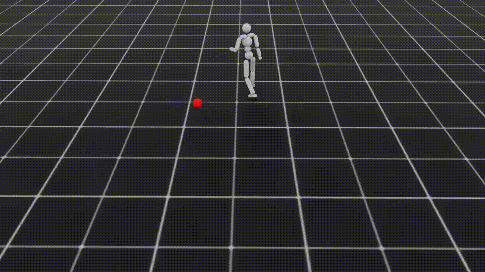

# move-it-move-it 


<table align="center" width="100%">
  <tr>
    <td align="center" width="33%">
      <a href="docs/videos/humanoid_motion_hero.mp4">
        
      </a>
      <sub><b>Humanoid Motion Imitation</b></sub>
    </td>
    <td align="center" width="17%">
      <a href="docs/videos/standing_broad_jump.mp4">
        
      </a>
      <sub><b>Standing Broad Jump</b></sub>
      <br>
      <a href="docs/videos/walk.mp4">
        
      </a>
      <sub><b>Walking</b></sub>
    </td>
    <td align="center" width="33%">
      <a href="docs/videos/humanoid_motion_hero.mp4">
        
      </a>
      <sub><b>Humanoid Motion Imitation</b></sub>
    </td>
    <td align="center" width="17%">
      <a href="docs/videos/standing_broad_jump.mp4">
        
      </a>
      <sub><b>Standing Broad Jump</b></sub>
      <br>
      <a href="docs/videos/walk.mp4">
        
      </a>
      <sub><b>Walking</b></sub>
    </td>
  </tr>
</table>

# Overview

The following codebase provides a flexible RL environment for learning diverse stylistic motions.

The environment is driven by a single manifest file that supports  motion-specific
rewards, termination conditions, task commands, behavior triggers, and optional AMP-style rewards. 


The following methods have been implemented:
- [Adversarial Motion Priors (AMP)](https://arxiv.org/abs/2104.02180)
- [DeepMimic](https://arxiv.org/abs/1804.02717)

## Installation

1.  This framework is built in [IsaacLab](https://github.com/isaac-sim/IsaacLab) and tested with `2e44ddb2e19536579140496023b5ccb060bc4152`.
2. Install using Isaac Lab's Python environment:

```bash
/path/to/IsaacLab/isaaclab.sh -p -m pip install -e . --no-deps
```


## Data
Download the motion data that was used from [Google Drive](https://drive.google.com/file/d/1xOpZKUo--7TSZqnA4kxun0gezIoPZx9m/view?usp=sharing) and unzip the archive into the repository's `data/` folder:

```bash
unzip <downloaded-archive.zip> -d data/
```

## Running

Train:

```bash
./isaaclab.sh -p scripts/train.py --algo <PPO|AMP> --manifest <manifest.yaml> --name <experiment_name>
```

Play a checkpoint:

```bash
./isaaclab.sh -p scripts/play.py --checkpoint <path>
```

Play a motion:

```bash
./isaaclab.sh -p scripts/play_motion.py --motion <path>
```
